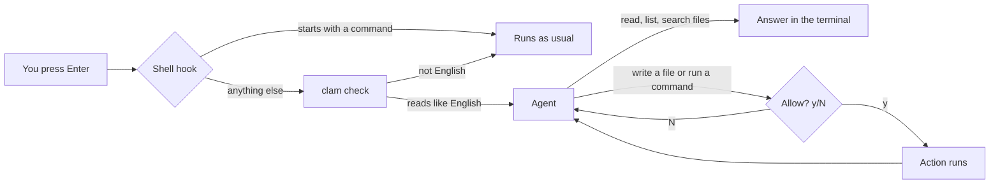

# clam

clam is an AI assistant for your terminal. It answers natural-language requests typed at a Bash, zsh or PowerShell prompt while leaving ordinary commands alone. It can inspect local files and, with approval, change files or run commands. Website: [dh1011.github.io/clam](https://dh1011.github.io/clam/)


## Install

On Linux, macOS or FreeBSD:

```sh
curl -fsSL https://raw.githubusercontent.com/dh1011/clam/main/install.sh | sh
```

The script downloads the binary for your OS and CPU from the [latest release](https://github.com/dh1011/clam/releases/latest), checks its SHA-256 checksum, and installs it to `~/.local/bin`. Set `CLAM_INSTALL_DIR` to put it elsewhere, or `CLAM_VERSION=v0.1.0` to pin a release. On Windows, download `clam-windows-amd64.exe` (or `-arm64`) from the release, rename it to `clam.exe`, and put it on your `PATH`.

clam is a single static binary with nothing else to install. The built-in agent needs an OpenAI API key:

```sh
export OPENAI_API_KEY=...
```

Then add one line to your shell's startup file and open a new terminal:

| Shell | File | Line |
|---|---|---|
| Bash | `~/.bashrc` | `eval "$(clam init bash)"` |
| zsh | `~/.zshrc` | `eval "$(clam init zsh)"` |
| PowerShell | `$PROFILE` | `clam init pwsh \| Out-String \| Invoke-Expression` |

Vim and Neovim can load this repository as a plugin (`plugin/clam.vim`); it makes `:!` answer English the same way, through `clam shell`.

### From source

With Go 1.24 or later, `make` builds `bin/clam`; put it anywhere on your `PATH`. `make dist` cross-compiles static binaries for every supported platform into `dist/`, with a `SHA256SUMS` file. `make test` runs the tests.

## Supported platforms

| | Supported |
|---|---|
| Shells | Bash, zsh, PowerShell 7 and Windows PowerShell (with PSReadLine), Vim and Neovim (`:!`) |
| Linux | amd64, arm64, armv7, 386 |
| macOS | Intel (amd64), Apple silicon (arm64) |
| Windows | amd64, arm64 |
| FreeBSD | amd64, arm64 |
| Agents | Built-in (OpenAI or any OpenAI-compatible Responses API), Codex, Claude Code, OpenCode, pi, or any command |

fish and other shells are not supported yet.

## How it works



The shell integration sees each line you enter: zsh through its Enter key widget, PowerShell through PSReadLine, and Bash through `command_not_found_handle`, which Bash calls only when the first word is not a command. A line that starts with a real command runs right away, unless that command is also a common English word such as `where` or `sort` (zsh and PowerShell then check the whole line first). For the rest, `clam check` decides locally, without a network call, whether the line reads like an English sentence; if not, the line runs (or fails) exactly as it would without clam. English goes to the agent, which works in the current directory and can call tools: reading, listing and searching files freely, and writing files or running commands only after you approve. Its answer is rendered as markdown in the terminal.

## Use

Type a question or request at the prompt. A line is treated as English only when it reads like a sentence and its first word is not a command, so typos and real commands behave as usual.

`clam on` and `clam off` toggle interception. `clam reset` clears conversation history for this terminal or editor session. Sessions are stored in `~/.cache/clam/sessions` with user-only access, expire after a day, and are not resumed by a new terminal.

The prompt shows `[c+]` when clam is on and `[c-]` when it is off, alongside any virtual environment indicator. In zsh it appears on the right side. Terminals known to draw color emoji (kitty, Ghostty, WezTerm, iTerm2, Konsole, GNOME Terminal and other VTE terminals, Windows Terminal, VS Code) show 🐚 for on, 🔥 for auto-approve and 💤 for off instead. Set `CLAM_EMOJI=1` or `CLAM_EMOJI=0` to override the guess. Set `CLAM_DEFAULT=off` before loading to start new terminals with clam off.

The agent can read, list, and search files in the directory where the request was entered. It asks before writing a file or running a command that is not on its small inspection allowlist. The approval prompt shows the action and accepts only `y` or `yes`; it denies actions when there is no interactive terminal. An approved shell command can access other paths shown in that command.

`clam auto on` skips these approval prompts in the current terminal, and `clam auto off` brings them back. While auto-approve is on, the prompt shows `[c!]` (or 🔥) instead of `[c+]`, and each action is printed as it runs. To make it the default, or to use it from Vim, set `CLAM_AUTO_APPROVE=1` in your environment. With auto-approve on, the agent runs any shell command it chooses without asking, and those commands are not limited to the current directory. Writes from the write tool stay confined to the current directory tree.

clam uses OpenAI's `gpt-6-luna` model. Set `CLAM_MODEL` to use another, and `OPENAI_BASE_URL` to use any server with an OpenAI-compatible Responses API.

## Other agents

clam can hand requests to another coding agent instead of its own: Codex, Claude Code, OpenCode or [pi](https://github.com/earendil-works/pi). Set `CLAM_AGENT` to `codex`, `claude`, `opencode` or `pi` in your shell's startup file, or run `clam agent codex` to switch the current terminal. `clam agent` lists the agents, shows which are installed, and marks the one in use; `clam agent builtin` switches back.

clam runs the agent in its non-interactive mode in the current directory, shows its answer and tool calls the same way, and resumes the agent's own session so each terminal keeps one conversation (`clam reset` starts a new one). The agent works under its own permission settings: clam's approval prompts and `clam auto` apply only to the built-in agent, and an agent that would normally ask before an action may refuse it when run non-interactively. Sign in to the agent or give it its API key as you normally would; `OPENAI_API_KEY` is needed only for the built-in agent.

For any other agent, set `CLAM_AGENT_CMD` to a command. clam runs it with `sh -c`, passing the request as its last argument and `CLAM_SESSION_ID` in the environment, and shows whatever it prints as the answer, rendered as markdown:

```sh
export CLAM_AGENT_CMD='my-agent --quiet'
```

The demo is recorded with [VHS](https://github.com/charmbracelet/vhs): run `vhs docs/demo.tape` from the repository root. It calls the real agent, so it needs `OPENAI_API_KEY` and each take differs slightly.
